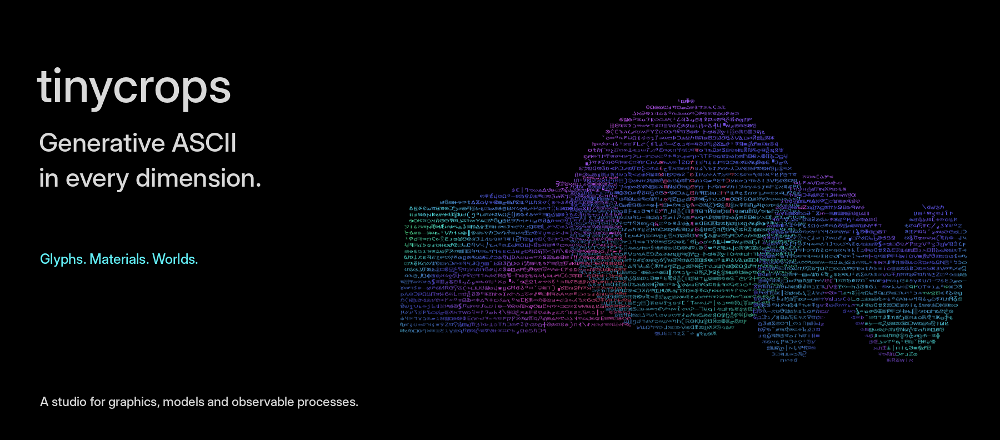
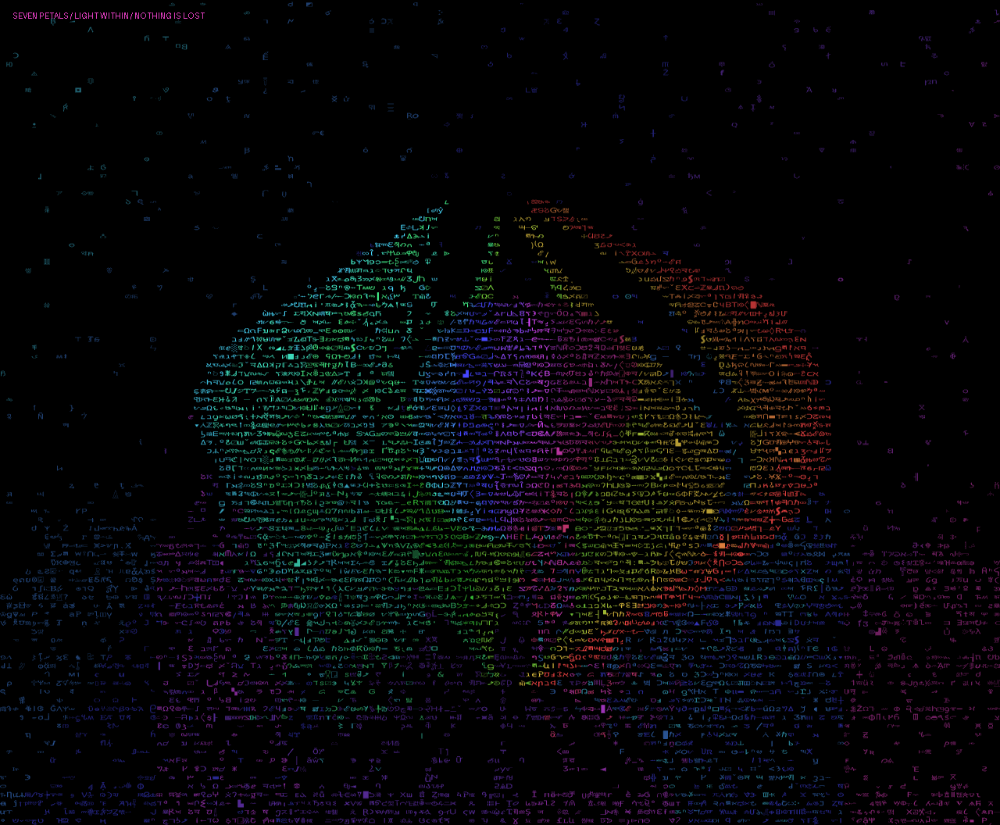

```text
/[0_0]\
\[\_:mango]/
```

<picture>

  

</picture>


<a href="assets/generative/tidal-weave.gif"></a>

<a href="assets/generative/breathing-knot.gif"></a>

<a href="assets/generative/night-murmuration.gif"></a>




<p>

  <a href="assets/petals/seven-petals-onebyone.gif"></a>

  <a href="assets/petals/seven-petals-together.gif"></a>

  <a href="assets/petals/seven-petals-wind.gif"></a>

</p>
