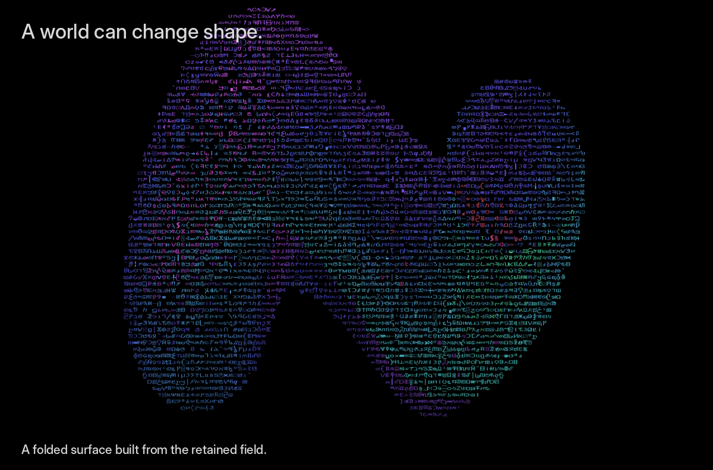

<picture>
  
</picture>

## Generative, observable, provable ASCII art

Exploring how glyphs become materials, objects and animated worlds.

Our studio brings together procedural graphics, local models and inspectable experiments. We work with character shapes, ink density and negative space across writing systems, following the same artwork from a flat field into spatial form.

### Glyphs become material

Different strokes and densities give us a richer vocabulary for texture, light and form.

### Material becomes a world

Preserve identities and construction data as an asset moves between representations.

### Keep the process observable

Retain sources, parameters and provenance. Distinguish authored geometry, model-generated material and measured results.

These images are reproducible procedural studies made with our shared glyph atlas. They illustrate the engine we are developing; they are not model-generated outputs or evidence of a completed universal engine.
