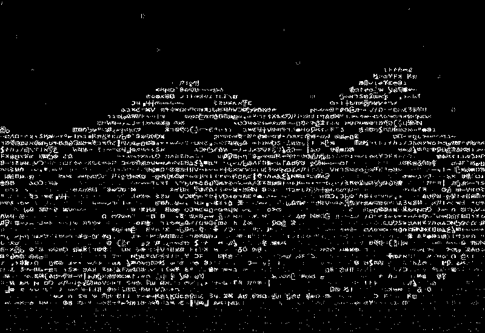
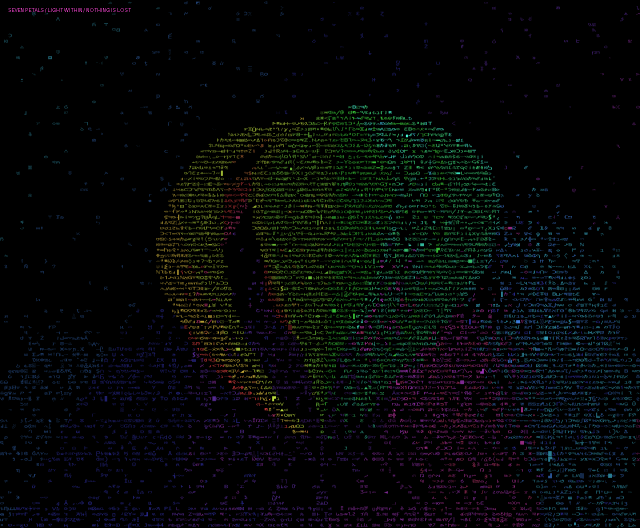
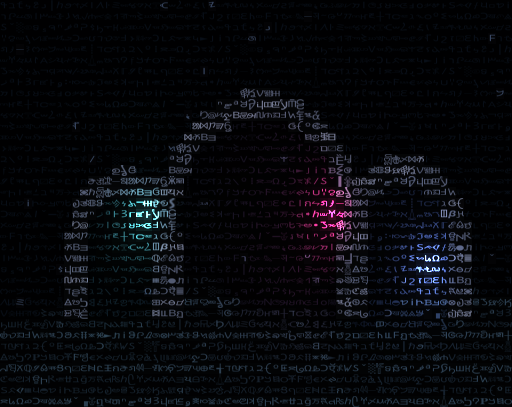

> the dither is the first challenge.

<picture>
  <source media="(prefers-reduced-motion: no-preference)" srcset="assets/generative/tidal-weave-dither.gif">
  
</picture>

<picture>
  <source media="(prefers-reduced-motion: no-preference)" srcset="assets/petals/seven-petals-profile.gif">
  
</picture>

[Seven Petals at full resolution](assets/petals/seven-petals-cycle.gif) · [Glyph gallery](docs/glyph-gallery.md)

<picture>
  <source media="(prefers-reduced-motion: no-preference)" srcset="assets/generative/observatory.gif">
  
</picture>

[Play Radiance Observatory](assets/generative/observatory.gif) · [Render source](generative/README.md#radiance-observatory)
