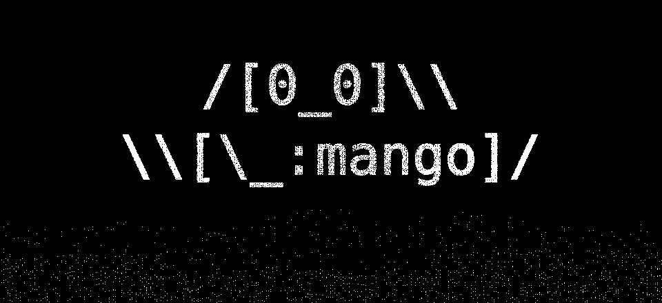

```text
/[0_0]\\
\\[\_:mango]/
```

<picture>

  

</picture>

<picture>
  <source media="(prefers-reduced-motion: no-preference)" srcset="assets/generative/observatory.gif">
  
</picture>

[Play Radiance Observatory](assets/generative/observatory.gif) · [Glyph gallery](docs/glyph-gallery.md) · [Render source](generative/README.md#radiance-observatory)
