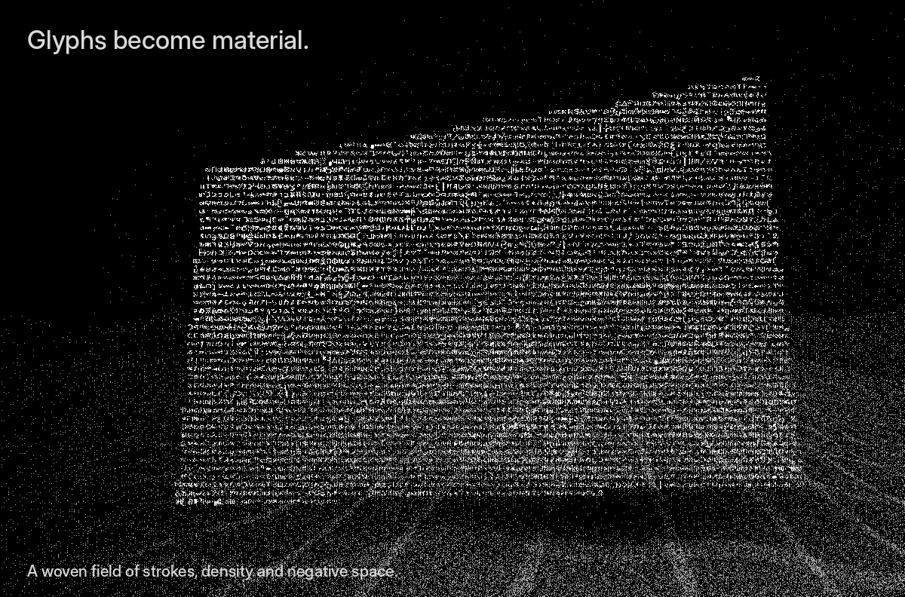

<picture>
  
</picture>

## Generative, observable, provable ASCII art

Exploring how glyphs become materials, objects and animated worlds.

Our studio brings together procedural graphics, local models and inspectable experiments. We work with character shapes, ink density and negative space across writing systems, following the same artwork from a flat field into spatial form.

### Glyphs become material

Different strokes and densities give us a richer vocabulary for texture, light and form.

### Material becomes a world

Preserve identities and construction data as an asset moves between representations.

### Keep the process observable

Retain sources, parameters and provenance. Distinguish authored geometry, model-generated material and measured results.

These images are reproducible procedural studies made with our shared glyph atlas, using a monochrome dither treatment inspired by my profile picture. The backgrounds are constructed separately, with distant ridges and a receding ground plane. They illustrate the engine we are developing; they are not model-generated outputs or evidence of a completed universal engine.

## Seven Petals — Light Within

Seven petals open around an inner light. They let go, drift into a constructed background, and grow again from within.

### Nothing is lost

A released petal comes apart glyph by glyph. Each glyph flies to its own place in the landscape and rests there as background, so the ground takes on the petal's colour. Then the glyphs run back to the inner light and the petal grows again.

### Letting go, three ways

  
  
  

One by one · together · carried by the wind. Select any of them for full size.

Procedural animation by Claude, extending Codex’s Seven Petals renderer. Mixed-script glyph surfaces from our shared atlas (all 156 script and style groups appear in every loop) and a separately constructed background. Authored geometry: no learned model chooses anything here, and these loops carry no hash-chain proof. 🥭
